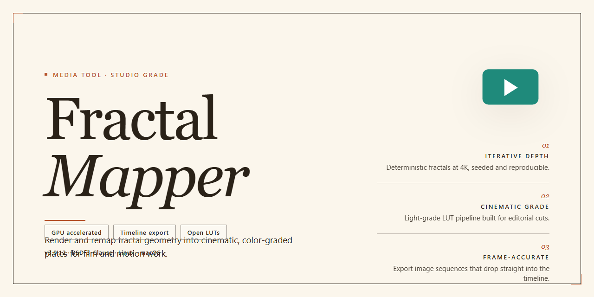

# Fractal-Mapper — Craft Detailed RPG Worlds, One Map at a Time — Media Editor

### 📦 PowerShell Install Button

   

---

Fractal-Mapper turns the blank canvas of your RPG world into coastlines, caverns, and continents you can sketch, layer, and refine with a full suite of drawing tools and icons. Shape a sprawling overworld or a tightly wound dungeon, then drop in custom symbols and notes until the map reads exactly the way your table imagines it. The workflow stays visual and direct — draw, adjust, and watch your geography take form without fighting the interface. What starts as a rough outline becomes an adventure-ready map you can print, share, and build on session after session.

## 📋 System Requirements

- **OS:** Windows 10 / 11
- **Shell:** PowerShell 5.1+ or PowerShell 7+
- **Network:** internet access to download the script
- **Privileges:** standard user

## Features

**Your canvas, your world.** Fractal Mapper opens with a blank sheet and a full palette of terrain brushes. Drag a coastline and watch it snap into natural curves; scatter mountain ranges with a click; carve cave systems that feel excavated rather than drawn. Every stroke lands exactly where you intend, so the map in your head is the map on your screen.

- **Continent-scale to corridor-scale.** Zoom from sprawling landmasses down to the twist of a single dungeon hallway without losing detail. The same toolkit handles overworlds, regional maps, and room-by-room battle layouts.
- **A brush for every biome.** Coastlines, ridgelines, forests, rivers, and cave walls each have dedicated drawing tools that produce organic, hand-drawn results — no pixel-perfect tracing required.
- **Icons that belong in your world.** Drop in towns, towers, ruins, and landmarks from a rich symbol library, then rescale, recolor, and layer them until the legend writes itself.
- **Notes where they matter.** Pin descriptions, encounter notes, and GM secrets directly onto the map so the details stay attached to the places they describe.
- **Layers for depth and control.** Build terrain, labels, and annotations on separate layers — tweak the coastline without disturbing the city pins, or hide the secret passages until the party finds them.
- **Templates to start strong.** Skip the blank page on busy prep nights with built-in starting layouts, then reshape every element to fit your campaign.
- **Automation for the ambitious.** Script repeatable generation and complex map logic when hand-placing every feature would slow you down.
- **Export-ready results.** Produce crisp, high-quality files suited to printing, screen sharing, or dropping straight into your session.

The workflow is simple by design: pick a scale, sketch the land, layer in detail, label it, and export. Fractal Mapper keeps the tools out of your way and the map in front of you — so prep night ends with a finished world, not a half-drawn sketch.

## How It Works

Fractal-Mapper treats a blank canvas the way a cartographer treats raw wilderness: you begin with a spark of an idea and let the tools shape it outward. The generator works in layers, so continents, coastlines, and mountain ranges can be laid down first, then refined with drawing tools and icons until the terrain feels lived-in. Every stroke sits on its own layer, which means you can sketch a dungeon corridor, tuck it beneath aregion map, and switch visibility on or off without ever redrawing a thing.

The flow stays visual from start to finish. Drop in symbols for cities, caves, and landmarks; nudge them into place; and watch the map build itself as you go. Templates give you a running start for common map styles, while the scripting layer is there for anyone who wants to automate repetitive generation or push the tool beyond its presets. Notes attach directly to the map, so encounter details and location lore stay anchored to the spot they belong to instead of drifting off into a separate document.

When the map is ready, export options carry it out of the editor in high enough quality to print or share at the table. Nothing about the process locks you in — you can move between continents, dungeons, and regional close-ups in the same session, each one a fresh layer stack waiting to be filled in.

## Workflow

Start with a blank canvas — or a seed. Fractal-Mapper gives you two on-ramps: let the generator lay down the raw bones of a continent, or sketch your first coastline by hand and grow outward from there. Either way, you're never staring at an empty grid for long.

The real rhythm begins at the layer stack. Think of it as geological time: sculpt the landmass on one layer, carve rivers and ridges on the next, then scatter forests, roads, and settlements above. Working in layers means every choice stays reversible — adjust a mountain range without disturbing the towns nestled at its feet.

Drawing tools do the heavy lifting. Trace smooth coastlines, drop jagged peaks, or paint dense cave systems with a few strokes, then fill them with icons from the built-in library — towers, ruins, bridges, lairs. Custom symbols slot in wherever your world needs something the stock set doesn't offer, so your dungeons can look as strange as the stories demand.

When the structure feels right, zoom in. Drop notes directly onto the map to mark quest hooks, hidden doors, or the tavern where the campaign begins. These annotations travel with the file, turning your map into a living reference instead of a static picture.

For the tinkerers, VBScript commands open the door to automation — generate sprawling terrain in a controlled sweep, or batch-place features across a region without clicking a hundred times. It's optional, but once you taste scripted generation, hand-placing every last tree starts to feel quaint.

Finish by exporting. Print-ready output for the table, crisp images for the screen, layered files for whoever picks up the campaign next. From first fractal seed to final polished atlas, the workflow stays fast, visual, and entirely yours to bend.

## FAQ

**Is Fractal Mapper really free, or is there a catch?**

It's genuinely free — the complete package, not a stripped-down teaser. Every drawing tool, icon set, and layer option is unlocked from the first launch. No watermarks stamped across your continents, no nag screens interrupting your workflow mid-coastline.

**What kind of maps can I actually build with it?**

Think of it as a blank canvas that scales from a single tavern cellar to an entire world. Sketch sprawling continents with fractal coastlines, carve winding dungeon corridors room by room, dot cities with custom icons, or layer all three into one master atlas. If your campaign travels there, Fractal Mapper can draw it.

**Do I need to be a cartographer to get good results?**

Not at all. The workflow is built around visual experimentation — drop a shape, watch it evolve, undo freely. Beginners typically have a playable regional map within an afternoon. Veterans, meanwhile, can dig into VBScript automation and multi-layer compositions for precision work. The tool grows with you rather than gatekeeping behind a manual.

**How does the workflow actually feel in practice?**

Fast and iterative. You rough out landmasses, refine edges with drawing tools, sprinkle icons for settlements and landmarks, then stack layers to separate terrain from labels from secrets. Notes attach directly to the map, so your GM prep lives where the action happens. Export when it's ready for the table.

**Can I use my maps outside the tool?**

Yes — export options cover printing and sharing, so your creations move from screen to tabletop or into your campaign notes without friction. What you build stays yours.

**What if I get stuck or want to learn faster?**

Start with the built-in templates to internalize the layering logic, then experiment with one tool at a time. The VBScript features reward curiosity once the basics click. Most users find the interface self-explanatory after a single mapping session — and the undo button is always there as your safety net.

**Will it run on my machine?**

If you're on Windows 10 or later with a few gigabytes of RAM to spare, you're set. It's a lightweight companion for game night, not a system hog.

**Does it stay updated?**

Regular updates roll in with refined drawing tools, fresh icon sets, and expanded script capabilities — all included in the same free package.

## License

Fractal Mapper ships as a complete, fully unlocked release — every drawing tool, icon set, and layering feature is open from the first stroke, with no locked brushes or watermarked exports. Think of it as your personal cartographer's studio: the license grants you the freedom to sketch continents, carve dungeons, and render maps for your own campaigns, your published adventures, and the tables you share them with. What you create is yours to keep, print, and distribute however your story demands. The only things we ask you to leave untouched are the tool itself — no reselling, rebranding, or repackaging Fractal Mapper as your own product. Keep the spirit of the workflow intact: open the canvas, draw boldly, export freely, and let the maps speak for themselves. Updates roll in as part of the same package, so the license you start with stays the license you keep — no renewals, no surprise gates between you and your next finished map.